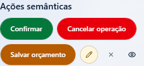
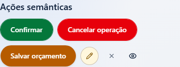
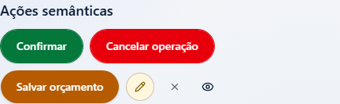
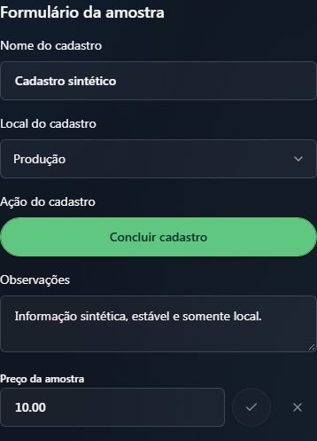
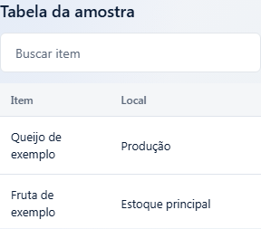
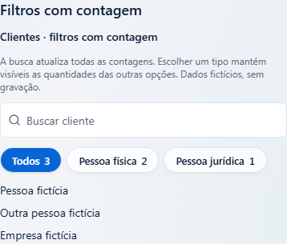
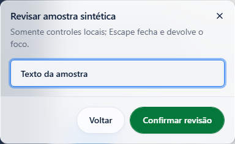
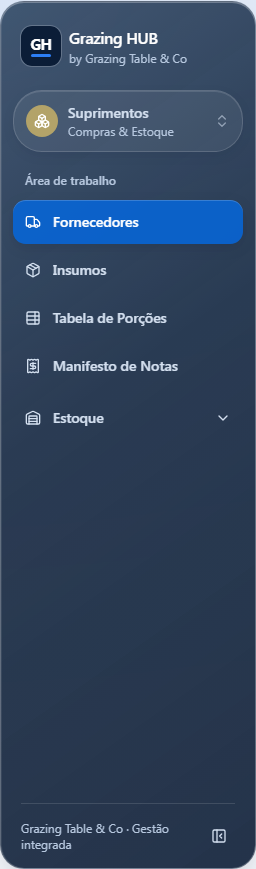

# Capturas locais da proteção visual — Em revisão

11 seções capturadas com componentes/CSS/tokens reais e dados fictícios. Estas imagens são evidência local Windows, com alterações da fixture ainda pendentes no momento da captura; a origem e os hashes estão em [origem-local.json](origem-local.json). Não aprovam telas, não entram no registro de referências e não bloqueiam por pixels. As capturas Linux do CI são a proposta apropriada para futura aprovação no ambiente fixado.

320/390/768/1440 fino significa viewport de desktop redimensionado. Os arquivos toque usam contexto de dispositivo com pointer:coarse confirmado. A tabela tem rolagem horizontal interna intencional; a lateral só aparece no ponto de quebra vigente.

## chromium-320-claro-fino · controles

## chromium-390-claro-fino · controles

## chromium-768-claro-fino · controles

## chromium-1440-claro-fino · controles

## chromium-390-escuro-toque · controles

## chromium-390-escuro-toque · formulario

## chromium-320-claro-fino · tabela

## chromium-390-claro-fino · filtros

## chromium-768-claro-fino · dialogo-painel

## chromium-1440-claro-fino · lateral

## chromium-390-escuro-toque · estados

