# Galeria Linux — candidatas de 13/10/2026

**Em revisão. Nenhuma imagem está aprovada ou bloqueia comparação de pixels.**

São componentes reais do HUB em laboratório com dados fictícios. Não são capturas de operações de produção. Imagens copiadas, sem alterações, do [CI Linux oficial](https://github.com/allanabrunhosa-cmyk/grazing-hub/actions/runs/38342215955), artefato 11787576916. O [registro de origem](origem-linux.json) preserva commit do checkout, projeto, caso, fonte, viewport, navegador e SHA-256 de cada PNG. O SHA-256 do ZIP foi conferido com o digest informado pelo GitHub.

Esta seleção não altera o registro de referências ou o baseline dos 98 desvios. A captura representa o checkout imutável do CI, incluindo a integração com a main; não confundir seu commit com o head da PR.

## Como revisar

1. Compare o mesmo componente, estado, tema e largura com a interface atual que você considera aprovada.
2. Confira cores, altura, alinhamento, texto, ícones, foco, cortes e hierarquia. Abra o PNG para ver o tamanho original.
3. Informe os IDs que aprova e as diferenças que deseja revisar. Aprovar uma imagem não aprova todos os temas, larguras ou estados.
4. A promoção para referência obrigatória ocorre em mudança própria, com a decisão humana e o head exato pelo [procedimento de aprovação](../../protecao-visual-automatizada.md). Nenhuma promoção é feita por esta galeria.

Observações: a tabela móvel preserva a rolagem horizontal interna; seu recorte não implica corte de controles. A lateral corresponde à navegação real do desktop, não a um novo drawer. Normal é o único estado desta primeira seleção; erro, vazio, conteúdo longo e salvando continuam nas evidências completas do CI.

## Botões

### CAND-01 — 320 px, claro, toque

Estado: **Em revisão**. Caso: normal.

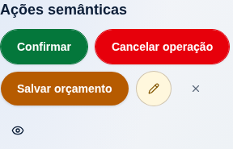

[PNG original](cand-01-chromium-320-claro-toque-controles.png) · 288 × 185 pixels.

### CAND-02 — 390 px, escuro, toque

Estado: **Em revisão**. Caso: normal.

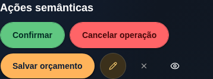

[PNG original](cand-02-chromium-390-escuro-toque-controles.png) · 358 × 133 pixels.

### CAND-03 — 768 px, claro, ponteiro fino

Estado: **Em revisão**. Caso: normal.

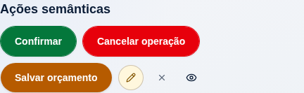

[PNG original](cand-03-chromium-768-claro-fino-controles.png) · 432 × 133 pixels.

### CAND-04 — 1440 px, claro, ponteiro fino

Estado: **Em revisão**. Caso: normal.

[PNG original](cand-04-chromium-1440-claro-fino-controles.png) · 1104 × 81 pixels.

## Formulários

### CAND-05 — 390 px, escuro, toque

Estado: **Em revisão**. Caso: normal.

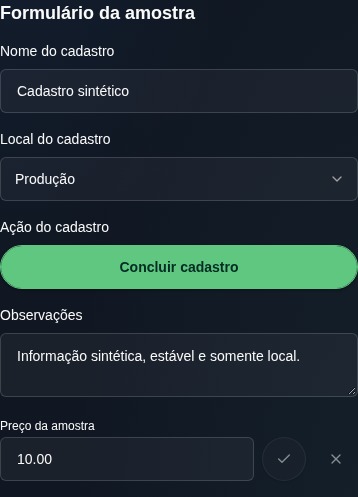

[PNG original](cand-05-chromium-390-escuro-toque-formulario.png) · 358 × 497 pixels.

### CAND-06 — 768 px, claro, ponteiro fino

Estado: **Em revisão**. Caso: normal.

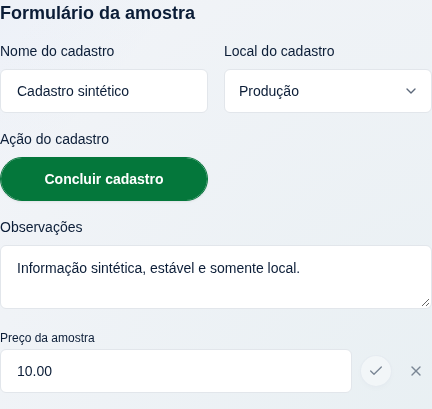

[PNG original](cand-06-chromium-768-claro-fino-formulario.png) · 432 × 409 pixels.

### CAND-07 — 1440 px, claro, ponteiro fino

Estado: **Em revisão**. Caso: normal.

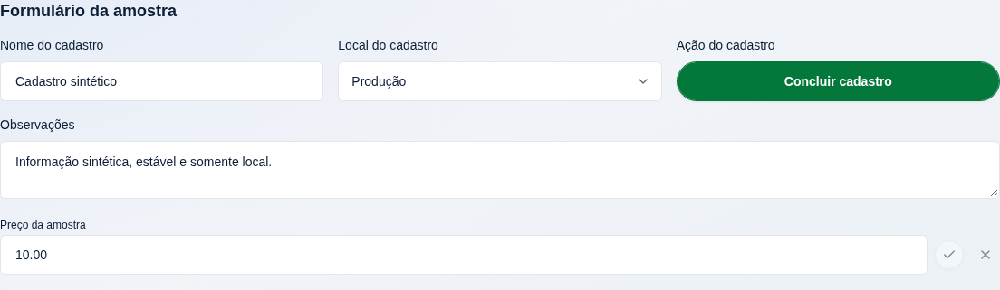

[PNG original](cand-07-chromium-1440-claro-fino-formulario.png) · 1104 × 321 pixels.

## Tabelas

### CAND-08 — 320 px, claro, ponteiro fino

Estado: **Em revisão**. Caso: normal.

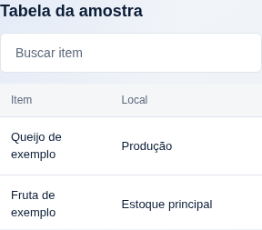

[PNG original](cand-08-chromium-320-claro-fino-tabela.png) · 288 × 253 pixels.

### CAND-09 — 1440 px, escuro, ponteiro fino

Estado: **Em revisão**. Caso: normal.

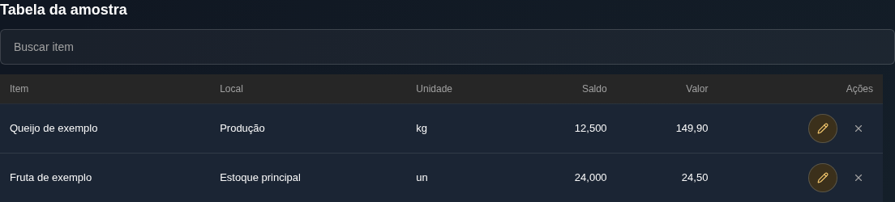

[PNG original](cand-09-chromium-1440-escuro-fino-tabela.png) · 1104 × 250 pixels.

## Modais

### CAND-10 — 320 px, claro, toque

Estado: **Em revisão**. Caso: normal.

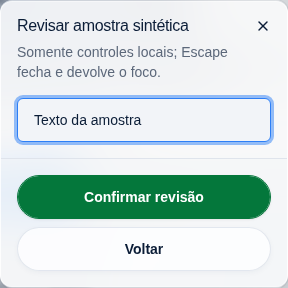

[PNG original](cand-10-chromium-320-claro-toque-dialogo-painel.png) · 288 × 288 pixels.

### CAND-11 — 768 px, claro, ponteiro fino

Estado: **Em revisão**. Caso: normal.

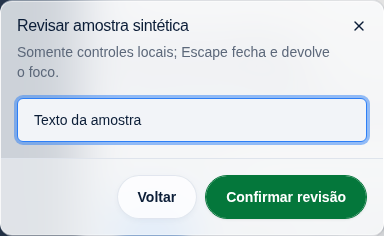

[PNG original](cand-11-chromium-768-claro-fino-dialogo-painel.png) · 384 × 236 pixels.

## Painel lateral

### CAND-12 — 1440 px, escuro, ponteiro fino

Estado: **Em revisão**. Caso: normal.

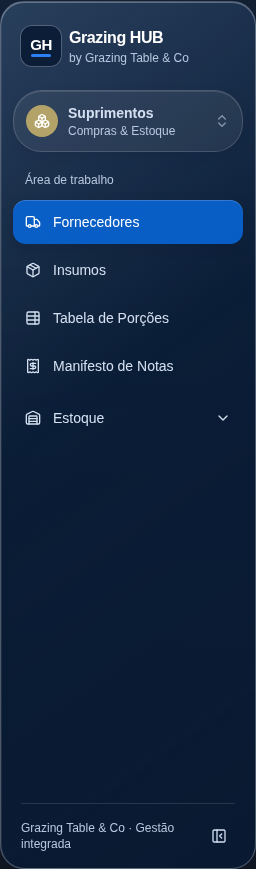

[PNG original](cand-12-chromium-1440-escuro-fino-lateral.png) · 256 × 869 pixels.
