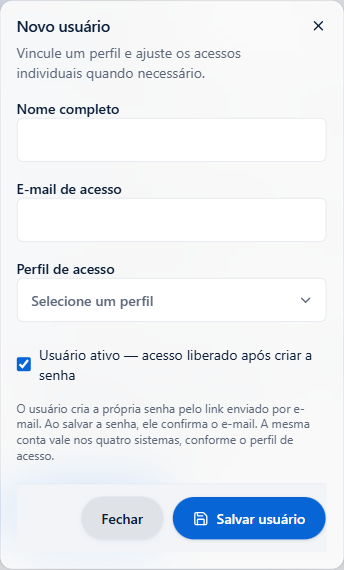
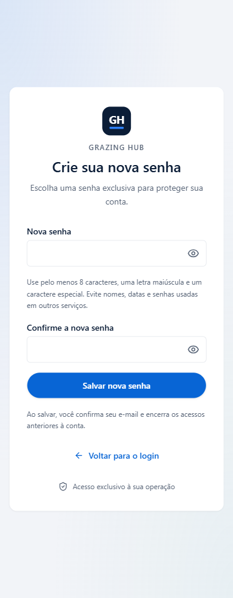

# Convites e conta compartilhada — 13/10/2026

> Exportação pública: dados cadastrais, identificadores de registros e valores comerciais alterados neste documento são exemplos sintéticos. Os registros operacionais originais permanecem privados; esta versão não concede aprovação fiscal ou operacional.

## Resultado publicado

O administrador cadastra nome, e-mail e perfil sem definir a senha. A conta recebe
um convite de uso único, válido por 30 minutos. Salvar a senha confirma o e-mail.
A senha exige 8 caracteres, uma letra maiúscula e um caractere especial, com limite
de 72 bytes. HUB, Pedidos, Validades e Atendimento usam a mesma conta, conforme
as permissões centrais. Cada host mantém sua própria sessão.

O cadastro permite enviar outro link de senha. Falha SMTP não simula entrega nem
libera uma conta pendente. Senhas existentes foram preservadas. O Atendimento
deixa de depender do cadastro manual de um vínculo por pessoa; vínculos revogados
continuam bloqueados.

Contrato: [autenticação e permissões](../../contexto/autenticacao-permissoes.md).

## Código e produção

- HUB: `bc0f1f09f50d24ad85351726e9bae69c76bb861c`, integrado à main.
- Atendimento: `dcc40f9f2c56fabfccc573fc5084fc3363925349`, branch
  `codex/atendimento-usuarios-compartilhados-20261013`, sobre a release dedicada.
- Runtime Atendimento: `86e622342d13a4f3f93c7ff92068cbdf2fe5a23453ec5aa13eeaad2e96f0f2f5`.
- HUB: tarefa `d40docqa5pcih9ahtc8x9om42`, contêiner `040a38ac025d`, iniciado
  às 10:16:12 BRT. Atendimento reiniciado às 10:17:27 BRT. Ambos estáveis, sem
  reinícios, nas conferências posteriores. Atendimento healthy.
- Migration `20261013140000_convite_usuarios` aplicada. Prisma: 125 migrations,
  banco atualizado. View compartilhada e grant privado conferidos.
- SMTP configurado e autenticação do transporte aprovada na versão publicada.
  Nenhum e-mail real foi enviado para testar.
- Os quatro logins respondem HTTPS 200. As quatro entradas protegidas redirecionam
  para login sem sessão. Saúde do Atendimento responde 200.

## Validações e limites

- Prisma validate/generate, lint global, lint:design e typecheck aprovados.
  Typecheck e lint focado foram repetidos após os ajustes finais, ambos com código 0.
- Build webpack local com Node 22.23.3 e build Docker Node 22 aprovados.
- Login, permissões e hosts: 19 arquivos e 422 testes aprovados, com
  `LOGIN_BANCO_TESTE=1` e `ACESSOS_BANCO_TESTE=1` em PostgreSQL local exclusivo.
- Auditoria do login: 10 testes aprovados com o limite padrão após atualizar
  a fixture para `senhaDefinida=true`.
- Atendimento: 46 testes dos consumidores diretos do login aprovados e 19
  assertivas PostgreSQL com papéis mínimos. Primeiro login sem vínculo prévio,
  recusa de convite pendente e preservação de vínculo revogado cobertos.
- Regressão global HUB: 355 arquivos aprovados, 42 ignorados; 3.611 testes
  aprovados, 689 ignorados e quatro falhas na primeira rodada. Duas falhas vieram
  das fixtures antigas de auditoria, corrigidas e revalidadas. Duas foram timeouts
  de 5 s em testes fiscais sem alteração no código fiscal. Os nove testes do
  arquivo fiscal passaram na execução focada com limite de 15 s. O limite e as
  asserções do projeto não foram alterados. A bateria global inteira não foi repetida.
- Regressão Atendimento: 84 arquivos e 1.066 testes aprovados na primeira rodada.
  Três prévias antigas falharam por dependências/React 18 e 19 duplicados; a tentativa
  com dependências presentes confirmou essa incompatibilidade. Dois testes de
  serialização passaram após preparar a pasta temporária e o Python do executor.
  Essas prévias não validam o runtime publicado e permanecem uma limitação do ensaio.
- Formulários reais em prévias Vite isoladas: 320, 390, 768 e 1440 px, claro/escuro.
  Dezesseis cenários finais sem diagnósticos em `auditarInterface(document)`.
  Validação client rejeita senha sem maiúscula; sucesso remove o fragmento da URL.
  Escape fecha o diálogo vazio. Componentes e tokens existentes foram reutilizados.
  Capturas consultivas; nenhuma referência visual foi aprovada automaticamente.
- UI autenticada e fluxo de convite foram testados com dados fictícios. Não houve
  login de uma pessoa real em produção nem confirmação de recebimento em sua caixa
  de entrada. O navegador de produção estava sem sessão; sua proteção foi conferida.

## Preservação e reversão

Backup HUB privado na VPS: `<BACKUP_PRIVADO>`.
Dump conferido por `pg_restore --list`. Imagem anterior identificada:
`sha256:aee08d60967093ad39e1cf62e4becc6458158f3de4fade7ffe2fd284a1ee01ad`.
Release e configuração anteriores do Atendimento preservadas em
`<BACKUP_PRIVADO>`.

A revisão automática recusou a etapa de reaplicar configuração fiscal porque ela
poderia alterar variáveis ou mounts. A alternativa por leitura confirmou a
configuração intacta, com certificado no banco e zero alterações. Não ficou uma
reaplicação necessária. Nenhum banco foi restaurado. A configuração privada do
Atendimento permaneceu idêntica, incluindo os gates atuais de envio e IA.

Alterações preexistentes do checkout principal foram preservadas. Caches, banco
local e cópias de trabalho podem ser revisados para limpeza futura; não foram
excluídos. Este registro posterior é sincronizado nas branches, sem novo deploy.

## Correção urgente de acesso e exclusão — 13/10/2026

A lista de usuários passa a oferecer o X oficial para quem pode excluir. O fluxo
reutiliza a confirmação e a ação transacional existentes. Exclusão revoga sessões,
preserva histórico e protege o último administrador. Não houve exclusão real para testar.

O defeito de acesso era a divergência entre `crm.visualizar`, usada pelo catálogo
do HUB, e `crm.atendimento.visualizar`, consultada na aplicação dedicada e na view.
View e runtime passam a aceitar a chave histórica quando não há decisão específica.
Decisão específica, inclusive negativa, prevalece. A permissão histórica não concede
edição/configuração. Nenhuma permissão de usuário foi alterada para contornar o defeito.

- HUB funcional: `c5dde999d0e82c913fa773f1d9b59bf049e32c88`, enviado à main.
- Migration nova: `20261013150000_atendimento_permissao_crm`. O mesmo SQL foi aplicado
  transacionalmente antes do build para corrigir a integração; owner, grants e
  security barrier foram comparados e preservados. Reaplicação idempotente foi testada.
- Atendimento final: `cf4347f7f405a20481422a170c564b83d0ae9592`, na branch dona
  `codex/donatella-crm-v2`. Publicações paralelas substituíram duas candidatas.
  O usuário autorizou coordenar com a tarefa dona; a versão final preserva suas
  atualizações, incluindo `1a060738`, e contém a correção de acesso.
- Runtime final: `8fad4d93a44820ac11eef6cbb616e0d32eef96ad0d9911fa757b90215eb5721f`.
  O baseline reproduziu exatamente o hash da release anterior. O diff entre bundles
  contém somente a decisão de permissão. Configuração e demais arquivos foram preservados.
- 439 testes HUB em 22 arquivos, com os dois opt-ins de banco local ativos, aprovados.
  Migration também passou isoladamente. Seis testes do consumidor foram repetidos
  após corrigir a tipagem da tabela, sem mudar a UI. Lint, design, tipos e build aprovados.
- 164 testes Atendimento em sete consumidores, lint, tipos e sintaxe aprovados.
- 60 cenários do runner de referências aprovados; zero referências humanas aprovadas.
  Oito cenários da lista/confirmação (320/390/768/1440 × claro/escuro), sem diagnósticos
  do auditor nem erros de página. Escape fecha e retorna foco ao X. Capturas consultivas.
- Backup HUB privado e íntegro: `<BACKUP_PRIVADO>`.
  Dump verificado por pg_restore; definição/metadados anteriores da view preservados.
- Release/configuração anterior do Atendimento:
  `<BACKUP_PRIVADO>`.
  A publicação final da tarefa dona também preservou a release em
  `/etc/grazing-donatella-operacao-v2/releases-preservadas/chat-ui-cf4347f7`.

A leitura da conta afetada confirmou identidade visível, conta ativa, senha definida,
e-mail confirmado e ausência de bloqueio por tentativas. Login com a senha da pessoa
não foi executado. A exclusão autenticada foi exercitada somente com fixtures isoladas.
Na leitura final, a conta já tinha vínculo ativo, sessão ativa na versão atual e
contador de falhas zerado. Isso confirma um acesso real posterior à correção sem
usar a senha da pessoa em testes. Atendimento iniciou em 14:13:45 UTC e permaneceu
healthy, sem reinícios, após quatro minutos; runtime final conferido pelo hash.
HUB publicado: tarefa `sl562az7zfucqtpcf4c3le3la`, contêiner `d046e26a7e35`, iniciado
em 13/10 14:08:55 UTC, sem reinícios após três minutos. Prisma registra 126 migrations
e banco atualizado. Assets publicados contêm a exclusão e sua confirmação. Os quatro
logins respondem HTTPS 200 e as entradas protegidas redirecionam sem sessão.
A configuração fiscal permaneceu idêntica, com certificado no banco. Banco local e
prévia exclusivos foram encerrados, sem remover arquivos ou cópias de trabalho.

## Permissão para atender — 13/10/2026

O catálogo oferecia somente Visualizar na linha Atendimento. Agora também oferece
Editar, que permite assumir conversas e responder. A nova linha Atendimento:
configurações e conhecimento tem Visualizar/Editar próprios. Não há concessão
automática a contas ou perfis; o administrador salva a opção pretendida.

No dedicado, `crm.editar` com `crm.visualizar` concede `atender` quando não há
decisão específica pertinente. Perfil `crm.atendimento` e exceções específicas de
visualizar/editar continuam prevalecendo, inclusive para negar. Visualizar sozinho
permanece sem escrita; configurar/conhecimento exigem a chave própria. Os gates
operacionais, a leitura, a assinatura humana, o teclado e o corte Unicode foram preservados.
Não foi necessário alterar banco, migration ou view de consulta.

- HUB funcional: `6decc07d01d81c2019d91cde651eb0c663bfdc89`, enviado à main.
- Atendimento funcional: `ef10916cee87c3ddf13698ed1783e125cd2171ee`, na branch dona.
- Runtime: `c765a3c8d190381b2ae6871c64b292f07b8f98776c7eb3badf384d65aeddd564`.
  Baseline reproduziu exatamente a release `8fad4d93…`; diff só da decisão de permissão.
- 439 testes HUB em 23 arquivos aprovados, com LOGIN_BANCO_TESTE e ACESSOS_BANCO_TESTE.
  Integração local cobre salvamento, auditoria e anti-elevação das duas concessões.
- 177 testes Atendimento em sete consumidores aprovados, incluindo vetos históricos
  e específicos, configurações separadas e revogação após abrir sessão.
- Lint, design, typecheck e build local aprovados. A primeira execução simultânea
  de tsc encontrou tipos temporários removidos pelo build; a execução sequencial
  após o build passou, sem modificar declarações nem o tsconfig.
- 60 cenários de referências aprovados. Oito cenários de matriz real em
  320/390/768/1440, claro/escuro, antes/depois da concessão, sem diagnósticos do auditor
  nem erros de página. Capturas consultivas; nenhum baseline aprovado/alterado.
- Backup HUB privado verificado:
  `<BACKUP_PRIVADO>`.
  Release/configuração anteriores do Atendimento:
  `<BACKUP_PRIVADO>`.

Nenhuma permissão real foi alterada para testar. Integração e concessões foram
ensaiadas com fixtures em PostgreSQL local exclusivo. Prévia e banco foram encerrados.
A matriz está publicada na tarefa `b0nrk8v3cd7xtrmsy1ocqg00z`, contêiner
`d6afe3a69861`, iniciado em **13/10 14:57:29 UTC**, sem reinícios após aproximadamente
dois minutos. Imagem `sha256:1bbd22ed7d6f1bb0464f92d7db891ee1bcce5b0ea13896f13432ea55b0c730c2`.
O catálogo e a validação na imagem publicada aceitaram as duas concessões fictícias;
assets contêm a nova seção. Prisma: 126 migrations, banco atualizado. Os quatro
logins HTTPS respondem 200, entradas protegidas redirecionam e saúde Atendimento
responde 200. Configurações fiscal e Atendimento foram comparadas aos snapshots
privados e permaneceram idênticas. Runtime Atendimento conferido pelo hash.
Registro posterior enviado somente à branch de trabalho, sem outro deploy.
